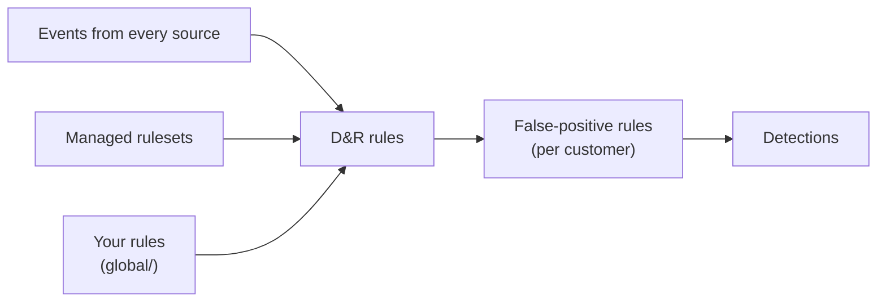
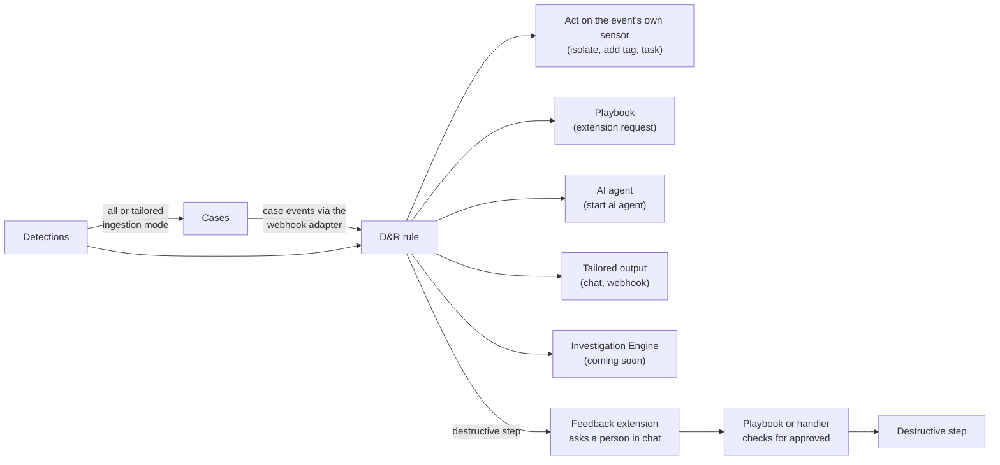

# Detection and Response

Part of [Recommended Deployment for MSSPs](index.md).

The telemetry and finding sources in this guide write events into the tenant. [Detection and response (D&R) rules](../../3-detection-response/index.md) are the one engine that acts on them: EDR, adapters, mail, cloud findings, App Control, vulnerabilities. This page covers how to build that layer once and run it in every tenant.

## Layer the rules

Build detection in three layers, each in its own place in Git:

| Layer | What it is | Where it lives |
| --- | --- | --- |
| Managed rulesets | Rules LimaCharlie or a partner maintains | Extension subscriptions in your shared template |
| Your rules | Northwind's own detections, written once | `dr-general` records in `global/` |
| Customer exceptions | False-positive rules and tags for one customer | `fp` records in that customer's folder |

### Managed rulesets

Start every tenant with the Soteria rulesets that match what it runs:

- [Soteria EDR](../../3-detection-response/managed-rulesets/soteria/edr.md) (`soteria-rules-edr`) for Windows, Linux and macOS endpoints.
- [Soteria AWS](../../3-detection-response/managed-rulesets/soteria/aws.md) and [Soteria Microsoft 365](../../3-detection-response/managed-rulesets/soteria/m365.md) where the customer runs those clouds. Each needs its adapter sending events first.

You can't read or edit Soteria's rules, so they are a baseline, not your detection content. Put your own on top (next section). Other managed sources exist for specific needs: [SOC Prime](../../3-detection-response/managed-rulesets/soc-prime.md) if you have a SOC Prime account, the [Community Rules](../../3-detection-response/managed-rulesets/community-rules.md) library for one-off additions, and the [Sigma converter](../../3-detection-response/managed-rulesets/sigma-converter.md) if you already hold Sigma rules you want to translate.

Each managed ruleset has its own subscription terms. The Soteria EDR rules bill per endpoint per month. Check each marketplace listing and the [pricing page](https://limacharlie.io/pricing).

### Your own rules

Write your rules once in `global/` and every tenant that includes the file runs them. For the coverage your customers care about, have AI draft the rules. List what matters to the customer (the systems they run and the risks they named) and the MITRE ATT&CK techniques you want covered. Then ask for one rule per item with `limacharlie ai generate-detection` and `limacharlie ai generate-response`, or `limacharlie ai generate-rule` for a whole rule. See [Writing and testing rules](../../3-detection-response/tutorials/writing-testing-rules.md#using-ai-to-build-a-detection). A generated rule is a draft. Validate it with `limacharlie dr validate`, test it, replay it over history, and only then merge it (next section). The [D&R rule building guidebook](../../3-detection-response/tutorials/dr-rule-building-guidebook.md) covers the language. The [walkthrough](../mssp-walkthrough.md#step-2-generate-rules-for-what-your-customers-care-about) shows the loop with commands, and its [catalogue of patterns](../mssp-walkthrough.md#step-4-a-detection-pattern-catalogue) is a source of examples.

Rules on adapter and product events work the same as rules on EDR events. A rule on `EMAIL_VERDICT`, `cloud_finding.created` or an Okta sign-in uses the same operators, the same response actions and the same suppression.

[Stateful rules](../../3-detection-response/stateful-rules.md) and [sensor variables](../../3-detection-response/sensor-variables.md) work per sensor. A mailbox, an adapter and an endpoint are different sensors, so a single rule cannot follow a sequence from one to the other. [What the products do together](synergy.md#what-is-not-supported) lists what to use instead.

### False positives per customer

Do not edit a shared rule to fit one customer. Add a [false-positive rule](../../3-detection-response/false-positives.md) in that customer's folder instead. FP rules filter the detections of every rule in the tenant, so ACME's software deployment tool is silenced for ACME and nobody else. The **Mark False Positive** button on a detection drafts one for you; copy the result into Git.

For exceptions that change behaviour rather than silence an alert, use a tag. A server ACME runs its backups from gets a tag, and your rule checks for it. The tag goes on that customer's installation key or the sensor, and the shared rule stays shared.

## Test before you ship

A change to `global/` reaches every tenant that includes it on the next pull, so test it first:

- **Unit tests.** A rule record can carry a `tests` block of events that should and should not match. LimaCharlie runs them when the rule is created or updated and refuses the rule if one fails. Stateful rules cannot carry tests. See [Unit tests](../../3-detection-response/unit-tests.md).
- **Sample events.** `limacharlie dr test --input-file rule.yaml --events samples.json` runs a rule over a file of events you keep next to it.
- **Replay.** `limacharlie replay run` runs a rule over a tenant's past events. Replay is billed per event evaluated. See [Replay](../../5-integrations/services/replay.md) and the walkthrough's [replay commands](../mssp-walkthrough.md#step-7-replay-against-historical-data-before-you-trust-it).
- **Pull requests.** Run both in your repository's CI, and merge only when they pass. The [IaC tutorial](../mssp-iac-tutorial.md#step-10-run-changes-through-pull-requests) shows the pull request flow and a structure check; add the rule tests to that CI job yourself.

## Threat intel, shared across products

Keep indicators in [lookups](../../7-administration/config-hive/lookups.md). The [Lookup Manager](../../5-integrations/extensions/limacharlie/lookup-manager.md) fetches feeds into `lookup` records every 24 hours. Your own block lists are lookups too.

One lookup serves several products:

- EDR and adapter D&R rules match against it with `op: lookup`.
- Email Security tests every link against the lookups named in a `threat_feeds` policy, and `dr-mail` rules can use `op: lookup` on links, attachment hashes and sender domains. See [IOC feeds](../../email-security/ioc-feeds.md).
- Rules on Cloud Security finding events can use it, as they can on any event.

Cloud Security's custom posture rules cannot: their operator allowlist excludes `lookup` (see [Custom rules](../../cloud-security/custom-rules.md)).

The walkthrough's [threat intelligence part](../mssp-walkthrough.md#part-13-threat-intelligence-and-lookups) has the feed and block-list setup.

## Cases: the shared queue

[Cases](../../5-integrations/extensions/limacharlie/cases.md) is the queue your analysts and agents work from. It is billed as a flat fee per organization per month, with no per-endpoint charge.

In the default `all` ingestion mode, a rule the extension installs forwards the tenant's detections to Cases, whatever product produced them (internal categories starting with `__` are left out). In `tailored` mode, only detections a D&R rule forwards with the `ingest_detection` action become cases. Pick `tailored` when a tenant produces detections you want to keep but not triage. [Auto-grouping](../../5-integrations/extensions/limacharlie/cases.md#auto-grouping) is on by default. Detections from the same sensor within a 24-hour sliding window join one case, and a matching case that was already resolved or closed is reopened rather than a new one opened. Set the grouping key and window in the template.

What feeds the queue:

| Source | How it reaches Cases |
| --- | --- |
| Your rules and managed rulesets | Their `report` actions in `all` mode, or an `ingest_detection` request in `tailored` mode |
| Cloud Security | The Cases toggle installs rules that open a case on each high or critical finding the feed emits, resolve it when the finding closes, and reopen it if it was closed while the finding is still open |
| Email Security | The opt-in Cases detection pack, which keys detections to the message group so copies of one phish share a case |
| Application Control | Four managed alert rules, off by default |
| Vulnerability Reporting | A rule you write on `vuln_finding.*` events |
| Host Posture (coming soon) | A shipped rule that reports each finding |
| Deception (coming soon) | A shipped rule pack. A qualifying live decoy hit is priority 10, a critical case under the default severity mapping, filed on the endpoint that held the decoy; token hits are cases with no sensor |

Cases has severity mapping, SLA targets, assignees, merging, notes, a dashboard and a summary report. Set the severity mapping, SLAs and `retention_days` in your onboarding script. Cases sends case events (creation, status changes, assignments, notes) to the organization's webhook adapter. Add that adapter in your template, and a D&R rule can react to a new case: start an AI agent, run a playbook, notify a channel. See [Webhook notifications](../../5-integrations/extensions/limacharlie/cases.md#webhook-notifications).

Two limits to plan around: Cases accepts up to 100 detections per minute per organization (fewer on the free tier), and a case's entities are added by people, agents or the API, not extracted automatically. [Cross-case entity search](../../5-integrations/extensions/limacharlie/cases.md#cross-case-entity-search) finds only what was attached.

### Getting alerts out

Send detections where your team works with a `detect` [Output](../../5-integrations/outputs/index.md). Outputs have no case stream: to notify on cases, write a D&R rule on the case events from the webhook adapter and send what it matches to a `tailored` output. Destinations include [Slack](../../5-integrations/outputs/destinations/slack.md), [Microsoft Teams](../../5-integrations/outputs/destinations/ms-teams.md), a [webhook](../../5-integrations/outputs/destinations/webhook.md) and [Tines](../../5-integrations/outputs/destinations/tines.md). For ticketing, use a webhook, or an extension such as [HaloPSA](../../5-integrations/extensions/third-party/halopsa.md), [ServiceNow](../../5-integrations/extensions/third-party/servicenow.md) or [PagerDuty](../../5-integrations/extensions/third-party/pagerduty.md). Webhooks can carry a shared secret so the receiver can check the signature; see [Allowlisting and signatures](../../5-integrations/outputs/allowlisting.md).

## Response

From detection to action:

The [response actions](../../8-reference/response-actions.md) an MSSP uses most:

| Action | What it does |
| --- | --- |
| `report` | Creates a detection. Cases picks it up in `all` mode, and a `detect` output delivers it |
| `isolate network` | Cuts the host off the network except for LimaCharlie |
| `add tag`, with an optional `ttl` | Moves the host into another policy: App Control lockdown, a stricter Exfil profile, a watch list |
| `task` | Runs a sensor command on the host: collect a file, list processes, dump memory |
| `extension request` | Calls any extension: a [playbook](../../5-integrations/extensions/limacharlie/playbook.md), [Reliable Tasking](../../5-integrations/extensions/limacharlie/reliable-tasking.md) for hosts that are offline, Email Security's mail actions |
| `output` | Sends the matched event to a named output on the `tailored` stream |
| `start ai agent` | Starts an AI session, with the event fields you pick passed as data marked untrusted |

Response actions act on the sensor the event came from. For an event from a mailbox, a firewall or the Cloud Security adapter, that is not the machine you want to act on. [What the products do together](synergy.md) shows how to reach the right host.

For destructive steps, put a person in the loop. The [Feedback extension](../../5-integrations/extensions/limacharlie/feedback.md) sends an approval request to chat and forwards the answer to a playbook or another handler. The handler receives every answer, a denial and the timeout choice included, so it must check for `approved` before it takes the destructive step. See [Human-in-the-loop response](../../5-integrations/tutorials/human-in-the-loop-response.md).

## Investigation Engine (coming soon)

The Investigation Engine is not generally available yet, and most of its documentation is not published.

<!-- TODO(link): Investigation Engine -> ../../investigation-engine/index.md -->

It investigates a detection or a case by following a plan template: it runs the plan's checks, in parallel where it can, stops when a rule in the template decides, and writes the result to the case. The rules your team writes make the decisions. AI answers focused questions inside the plan, and decides alone only where your policy allows it.

What it may do is declared in an [`investigation_policy` record](../../7-administration/config-hive/investigation-policy.md). Each class of action has one of four modes:

| Mode | Behaviour |
| --- | --- |
| `off` | The engine does not propose it |
| `suggest` | The engine records what it would do and does nothing |
| `approve` | The engine asks for approval and acts only on a yes before the deadline |
| `auto` | The engine acts when the policy's limits, confidence, permissions and evidence checks pass; otherwise it holds the action as a suggestion |

Nothing in the engine changes these modes on its own: no history, score or sampling promotes an action. The console's pause writes a policy record that caps every class at `approve`: investigations keep running, and nothing acts without a person's yes. Policies and plan templates are records, so Git Sync rolls them out; see [Investigation policies and plans](../../5-integrations/extensions/limacharlie/git-sync.md#investigation-policies-and-plans). An investigation starts without a person only from a D&R rule.

For a new tenant, start with `close.false_positive` on `suggest` and every eradication action on `approve`, read what the engine would have done on real cases, then move the classes you trust to `auto`.
