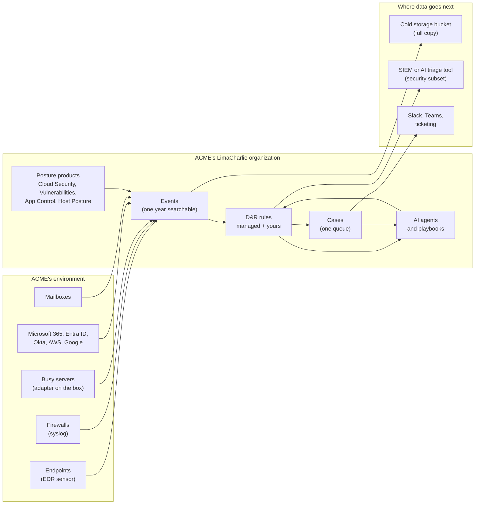
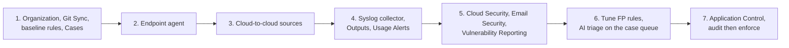

# Recommended Deployment for MSSPs

This guide answers one question that service providers ask early: what is the best way to deploy LimaCharlie in a customer's environment? Not "it depends". A default you can follow for most customers and change when a customer gives you a reason.

It is written for MSSPs, MSPs, MDR and incident response firms that run many customers, each in its own LimaCharlie organization. It covers the products a standard MSSP rollout uses, how we expect you to roll each one out across thousands of tenants, how it is configured as code and how it is billed. Most of all, it covers what the products do together, because that is where most of the value is.

Two other pages cover the rest of the job:

- The [MSSP walkthrough](../mssp-walkthrough.md) covers running the business on LimaCharlie: your control organization, access for your staff and your customers, billing, a first detection set, alerting, and a smoke test.
- [Run Your MSSP from Git with Git Sync](../mssp-iac-tutorial.md) is the step-by-step setup of the Git repository that configures every tenant.

This guide links to both and does not repeat them. The examples use the walkthrough's fictional MSSP, **Northwind Security**, and its customers **ACME** (Windows and Microsoft 365), **Globex** (AWS, Linux and Okta) and **Initech** (Macs and Google Workspace).

## How to think about LimaCharlie

**It is infrastructure.** LimaCharlie sells to you, the provider. You own the customer relationship, and you choose what goes into each offering and how you price it. The platform gives you the parts: sensors, log intake, a detection engine, storage and search, response, and a set of products built on those parts. You decide how they add up to a service.

**Deterministic automation first, AI on top.** Detection and response rules, false-positive rules, playbooks and policies are code you can read, test and replay. They run the same logic every time and spend no tokens. AI agents work on top of that: they triage, investigate, write and tune the rules, and call the deterministic pieces. When an AI keeps doing the same steps, you ask it to turn those steps into a rule or a [Python playbook](../../5-integrations/extensions/limacharlie/playbook.md) so the next run costs seconds of compute instead of tokens. See [AI as a main user](ai.md).

**Bring in a superset, route it out.** Send LimaCharlie everything you might need for detection and investigation. Insight, the built-in retention that is on by default, keeps a year of those events searchable. Then use [Outputs](../../5-integrations/outputs/index.md) to send an unfiltered copy to cheap long-term storage and only the subset that matters to whatever comes after it: your SIEM, an AI triage tool, the customer's own system. Doing the routing in the LimaCharlie cloud means you never touch the customer's firewall to change where data goes. See [Telemetry and routing](telemetry.md).

**Everything is declared as configuration.** Every rule, policy, adapter, output and agent is a record you can write in YAML. One template, kept in Git, rolls out to every tenant that includes it. There is no per-tenant testing step. Any state a rule keeps, such as a suppression count, is declared in the rule itself. Git Sync carries the records of every product in this guide. [Operations](operations.md#what-to-keep-out-of-git-sync) lists the few that hold credentials, which CI writes from its own secret store instead.

**One organization per customer.** Each customer is an isolated tenant with its own sensors, data, rules and billing. Your staff reach them through Organization Groups. The [walkthrough](../mssp-walkthrough.md#the-opinionated-mental-model) and [Designing access](../../7-administration/access/designing-access.md) explain the model.

## The stack for one customer

Every source you connect for a customer writes events into the same organization, so the rules, Outputs, Cases and AI agents you configure there can act on any of it.

## The products

The table lists every product an MSSP is likely to deploy. Units only: the numbers are on the [pricing page](https://limacharlie.io/pricing). Products marked **Coming soon** are not generally available yet.

| Product | What it gives you | Configured as code | Billed |
| --- | --- | --- | --- |
| [Endpoint agent (EDR)](../../2-sensors-deployment/index.md) | Process, network, file and DNS telemetry, live response, isolation, and the base for App Control, Vulnerabilities, Integrity, YARA and Deception | [Installation keys](../../2-sensors-deployment/installation-keys.md) carry the tags; [Exfil](../../5-integrations/extensions/limacharlie/exfil.md) rules pick the events | Per endpoint per month, flat, with a year of retention. [Sleeper](../../2-sensors-deployment/endpoint-agent/sleeper.md) sensors bill on usage |
| [Adapters](../../2-sensors-deployment/adapters/index.md) | Logs from cloud, SaaS, identity, firewalls, servers and other security tools | `cloud_sensor` records; `external_adapter` records set from CI (they hold credentials) | Per GB received, counted once at ingestion, with a year of retention. A few third-party sources have their own plan |
| [Outputs](../../5-integrations/outputs/index.md) | Copies of events, detections and audit logs to storage, a SIEM or chat | `outputs:` in Git Sync | Egress at cost; [GCP outputs in the datacenter's own region](../../5-integrations/outputs/billing.md) are not charged |
| [Search (LCQL)](../../4-data-queries/index.md) | A year of retained events, searchable across the tenant | Saved queries in the `query` hive | Per events evaluated |
| [D&R rules and managed rulesets](../../3-detection-response/index.md) | Detection and automated response on every event | `dr-general`, `fp`, `lookup` records | Managed rulesets bill per their marketplace listing. The Soteria EDR ruleset is per endpoint per month; other Soteria sets have their own plans |
| [Cases](../../5-integrations/extensions/limacharlie/cases.md) | One alert queue across products, with SLAs and reports | Subscription in `extensions:`; settings through the Cases API in your onboarding script | Flat fee per organization per month, with no per-endpoint charge |
| [Cloud Security](../../cloud-security/index.md) | Cloud and SaaS posture, attack paths, asset inventory and coverage gaps, Entities, mail posture rules, Code Security | `cloudsec_*` records | Flat per organization per month; Code Security per protected repository, counted daily. [Free tier](../../cloud-security/free-tier.md) |
| [Email Security](../../email-security/index.md) | Post-delivery mail protection for Microsoft 365, Google Workspace and IMAP | `mailsec_*` and `dr-mail` records | Per protected mailbox per month, counted daily; the mail events bill as adapter data. [Free tier](../../7-administration/billing/security-products.md) |
| [Vulnerability Reporting](../../5-integrations/extensions/limacharlie/vulnerability-reporting.md) | Package inventory matched to CVEs, ranked with KEV, EPSS and your asset tags | `extension_config` record | Per endpoint per month |
| [Application Control](../../5-integrations/extensions/limacharlie/app-control.md) | Allow or block programs at process start, audit first; one-tag lockdown | `app_control_policy`, `app_control_rule` records | Per endpoint per month |
| Host Posture (**Coming soon**) | Configuration checks on each host, mapped to standards | `host_posture_rule` records | No extension charge today; pricing may be set at launch |
| Deception (**Coming soon**) | Decoys on endpoints and tokens you place yourself; a hit is a high-signal alert | `extension_config` record | Pricing is set at launch |
| [Integrity (FIM)](../../5-integrations/extensions/limacharlie/integrity.md) | File and registry change alerts | `extension_config` record | No extension charge |
| [YARA Manager](../../5-integrations/extensions/limacharlie/yara-manager.md) | YARA rule sets kept in sync from your sources | Rules land in the `yara` hive | No extension charge |
| [EPP](../../5-integrations/extensions/limacharlie/epp.md) | Microsoft Defender status, logs and commands | Subscription; the extension writes its collection and D&R rules | No extension charge |
| [AI Sessions and SOC Bots](../../9-ai-sessions/index.md) | AI agents that triage, investigate and operate the tenant | `ai_agent` records | Per minute of session runtime; the model's tokens are billed by your own AI provider |
| [Python Playbooks](../../5-integrations/extensions/limacharlie/playbook.md) | Deterministic Python steps called by rules or agents | `playbook` records | Per second of execution time |
| [Investigation Engine](../../investigation-engine/index.md) (**Experimental**) | Template-driven investigations that act as each template says, inside a per-tenant pause and circuit breaker | `investigation_plan`, `investigation_pack`, `investigation_policy` records | Pricing is set at launch |

<!-- TODO(link): Host Posture -> ../../5-integrations/extensions/limacharlie/host-posture.md -->
<!-- TODO(link): Deception -> ../../5-integrations/extensions/limacharlie/deception.md -->

There is no separate charge for using the API, the CLI or the MCP server. Metered operations, such as searches, playbook runtime and AI session runtime, bill the same whichever interface starts them.

## Recommended rollout order

This is the order Northwind follows for a new customer such as ACME. Each step builds on the one before. Apart from installing software at the customer, each step is a change to the customer's folder in Git or to a shared template it includes.

1. **Create the organization and the template.** Create the organization in the right region, add it to your Organization Groups, connect Git Sync, subscribe the standard extensions and the Soteria rulesets, turn on your baseline rules and Cases. *Why first:* the template is ready before any data arrives, so the first event already meets your rules. Run the walkthrough's [onboarding script](../mssp-walkthrough.md#automate-the-new-customer-onboarding) on the new organization, merge the customer's `index.yaml`, then run a first Git Sync apply and check its result before you connect sources or send installation keys.
2. **Install the endpoint agent.** Use role-based installation keys (servers, workstations, VIPs). Pre-deploy to machines you are not monitoring yet in sleeper mode. *Why:* endpoints are the richest source and the base for most other products. Tags from the key target everything later.
3. **Connect cloud-to-cloud sources.** Microsoft 365, Entra ID or Okta, Google Workspace, AWS CloudTrail. *Why:* there is nothing to install at the customer, and identity and cloud audit logs are high-value and low-volume.
4. **Add the syslog collector and Outputs.** Put one cloud-managed adapter on a customer server as the syslog collector for firewalls and other appliances, and filter on the devices. Add Windows Event Log collection where it is needed. Then add Outputs: full event copy to a bucket, detections to the SIEM or triage tool, audit log to long-term storage, with Usage Alerts on output volume and a check on ingestion volume. Add Integrity rules and YARA Manager sources where the customer needs them. *Why:* network logs are usually the largest source, so decide the filter before you turn them on. Once real volumes arrive you can size and alert on them.
5. **Turn on the posture products.** Cloud Security with the customer's cloud accounts and identity provider; Email Security on their mail; Vulnerability Reporting on their endpoints. *Why:* posture work starts once inventory exists. Cloud Security also builds the User and Host directory the other products join on.
6. **Tune.** Write false-positive rules for the customer's own software, and record their exceptions as tags. Start AI triage on the case queue. *Why:* the first alerts tell you what this customer's normal looks like.
7. **Add Application Control.** Run it in audit mode on a pilot tag, then enforce. Add Deception and Host Posture when they are available. *Why:* these need a quiet baseline and a tuned queue, or they add noise.

## Reference packages

Three packages, from minimal to full. Most providers sell something close to one of these and add products as the customer grows.

### Essentials: managed detection and response

- Endpoint agent on every computer and server, with Exfil defaults and a few Event Collection rules.
- Identity and Microsoft 365 or Google Workspace adapters.
- The Soteria rulesets plus Northwind's own rules, drafted with AI for each customer's priorities and ATT&CK techniques and tested before rollout, with per-customer false-positive rules.
- Cases as the queue, with an AI triage agent on new cases.
- Outputs: full copy to a bucket in the same region, detections to Northwind's SIEM.

### Standard: detection plus posture

Everything in Essentials, plus:

- Firewall and server logs through a syslog collector adapter.
- Cloud Security for the customer's cloud and SaaS accounts, with the opt-in Cases rules for high and critical findings.
- Email Security on every mailbox, with its Cases detection pack.
- Vulnerability Reporting with asset tags set by the installation keys.

### Full: managed protection

Everything in Standard, plus:

- Application Control, audit first, then enforcing by tag. For automatic containment, create the reserved lockdown policy in each organization, then add a D&R rule that tags a host into it. See [Automate lockdown with D&R](../../5-integrations/extensions/limacharlie/app-control.md#automate-lockdown-with-dr).
- Integrity rules for the customer's regulated systems, and YARA Manager sources.
- Host Posture and Deception when they launch.
- Playbooks for the response steps your analysts and agents repeat.

## In this guide

| Page | What it covers |
| --- | --- |
| [Telemetry and routing](telemetry.md) | Endpoints, logs, identity and SaaS; filtering at the source; busy hosts; routing data out; retention and billing shape. |
| [Protection and posture](protection-posture.md) | Cloud Security, Email Security, Vulnerabilities, Application Control, Integrity, YARA, EPP, Host Posture and Deception. |
| [Detection and response](detection-response.md) | Managed and custom rules, false positives, testing, threat intel, Cases and response. |
| [What the products do together](synergy.md) | The chains between products, the mechanism behind each one, and what is not supported. |
| [AI as a main user](ai.md) | AI-driven setup, managing many tenants through Git, investigation agents, playbooks, and custom portals. |
| [Operations](operations.md) | Running it all day to day across thousands of tenants. |
