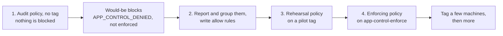

# Protection and Posture

Part of [Recommended Deployment for MSSPs](index.md).

Detection tells you something happened. The products on this page work before that: they find the weak configuration, the unpatched package and the forwarding rule before an attacker does, and they stop programs that should never run. For a provider, they are also the easiest part of the service to show a customer, because each one produces a list of things to fix.

Three patterns repeat across all of them:

- **Each product is configured by records.** Policies, rules and connections are YAML you keep in Git and push to every tenant. Most go through Git Sync, including Application Control. Git Sync does not cover Email Security and Cloud Security records yet: you push those from the same repository with the CLI in your CI. See [Operations](operations.md#what-git-sync-does-not-cover-yet).
- **Sensor tags decide where each one applies.** App Control policies, Host Posture rules, Deception policies and Integrity rules all target tags. Put the tags on the installation keys and a new machine falls under the right policies from enrollment. Each product then acts on its own schedule: App Control on the sensor's next sync, Host Posture on its next sweep, Deception at first connection when its policy places decoys on new sensors. Moving a machine between stages is a tag change.
- **Each product writes events into the same organization.** Findings and hits become events. D&R rules, shipped or yours, turn the ones you care about into detections, and Cases picks those up. See [What the products do together](synergy.md).

## Cloud Security

**What it is.** Agentless posture for the customer's cloud and SaaS accounts in the same tenant: inventory and misconfigurations, attack paths, identity and permission analysis, data you declare sensitive, compliance frameworks, a merged asset inventory with coverage gaps (CAASM), a User and Host directory (Entities), [mail posture rules](../../cloud-security/mail-posture-rules.md) and [Code Security](../../cloud-security/code-security/index.md). It connects to AWS, GCP, Azure, Okta, Entra ID, Google Workspace, GitHub, GitLab and more with read-only credentials. See [Cloud Security](../../cloud-security/index.md).

**When.** Week 2, once the customer's cloud and identity accounts are known. Turn it on even for customers with little cloud: Entities and the asset inventory work from LimaCharlie sensors alone, and other products join on them.

**At scale.** Each connection is a `cloudsec_provider` record with its credential in the `secret` hive. Policies (classification, coverage expectations, suppressions, SLAs) are `cloudsec_policy` records. Git Sync does not carry `cloudsec_*` records yet, so your CI pushes them for each tenant with `limacharlie sync push --config-file cloudsec.yaml` and the `--hive-cloudsec-*` flags, or loops `limacharlie hive set` over the files in your repository. The docs show [onboarding a tenant](../../cloud-security/automation.md#onboarding-a-tenant), a [multi-tenant policy push](../../cloud-security/automation.md#multi-tenant-policy-push) and the [record reference](../../8-reference/cloud-security-api-iac.md). For the cross-tenant view, `limacharlie cloudsec fleet overview` rolls risk up across the organizations you manage (see [Cloud Security CLI](../../cloud-security/cli.md)).

**What it produces.** A worklist of findings ranked by risk, and `cloud_finding.created`, `.closed` and `.still_open` events in the tenant's event stream. The Cases toggle in Cloud Security's settings installs three D&R rules: one opens a case for each high or critical finding the feed emits, one resolves the case when the finding closes, and one reopens a case that was closed while its finding is still open. See [Findings and Cases automation](../../cloud-security/automation.md#findings-cases-automation).

**Billed.** A flat base fee per organization per month. Code Security adds a charge per protected repository, counted daily. Organizations on the free tier get a [perpetual free allowance](../../cloud-security/free-tier.md).

## Email Security

**What it is.** Post-delivery protection for mailboxes: Microsoft 365 and Google Workspace through their APIs, and other mailboxes over IMAP. No MX change and nothing in the mail path. Each message it ingests gets a verdict with the signals behind it, and you can quarantine, move, banner or restore at the provider. It does not replace the provider's own filtering. Coverage and remediation differ by provider; check the provider setup page for each. See [Email Security](../../email-security/index.md).

**When.** Week 2. Start with the default automations, which only alert, and turn on actions per customer once you trust the verdicts on their mail.

**At scale.** Every piece of configuration is a record: `mailsec_provider` for the connection, `mailsec_policy` for automations, exclusions, VIPs, thresholds, banners and retention, and `dr-mail` for custom mail rules. Records compose in name order, and unknown fields are refused, so a typo fails the write instead of turning off a control. Onboarding a tenant is a script. See [Configuration as code](../../email-security/automation.md#configuration-as-code). Git Sync does not carry these records: push `dr-mail` and `mailsec_policy` with `limacharlie sync push --config-file mail.yaml --hive-dr-mail --hive-mailsec-policy` (see [Email Security rules as code](../../email-security/custom-rules.md#infrastructure-as-code)), and `mailsec_provider` the same way with `--hive-mailsec-provider`, or with a `limacharlie hive set` loop.

**What it produces.** Each mailbox is its own sensor on the `email` platform, with `EMAIL_MESSAGE`, `EMAIL_VERDICT`, `EMAIL_ACTION` and `EMAIL_USER_REPORT` events. Ordinary D&R rules act on them. The [opt-in Cases detection pack](../../email-security/groups.md#opt-in-cases-detection-pack) reports malicious, suspicious and user-reported messages and keys each detection to its message group, so a phish sent to forty people is one case, not forty.

**Mail posture is a separate thing.** Forwarding rules, delegates, transport rules and DMARC, DKIM and SPF are configuration, and Cloud Security's [mail posture rules](../../cloud-security/mail-posture-rules.md) check them. Email Security looks at messages. Run both.

**Billed.** Per protected mailbox per month, counted daily. Shared mailboxes count once. Analysis is included; the mail events the mailbox sensors send are billed as adapter data. Mailbox sensors do not count against the sensor quota. Free-tier organizations get up to ten mailboxes. See [Security products billing](../../7-administration/billing/security-products.md).

## Vulnerability Reporting

**What it is.** By default, a daily package inventory from each supported Windows, macOS and Linux sensor, matched to CVEs, enriched with CISA KEV and EPSS, and ranked with an LC Risk score that uses your asset tags. A finding closes when a later inventory shows it no longer applies. Analysts can also mark one mitigated, accepted or false positive. See [Vulnerability Reporting](../../5-integrations/extensions/limacharlie/vulnerability-reporting.md).

**When.** Week 2, once sensors are in.

**At scale.** Put [asset tags](../../2-sensors-deployment/asset-tags.md) (`lc:asset:criticality:*`, `lc:asset:exposure:*`, `lc:asset:env:*`) on the installation keys, so a production server is scored as one from its first scan, with no per-tenant work. The extension's settings are an `extension_config` record, and `criticality_tag_overrides` maps tags you already use to the canonical values.

**What it produces.** `vuln_finding.created`, `.closed`, `.kev_match` and `.state_changed` events. They are events, not detections: route them with an Output, or write a D&R rule that reports the ones you care about (for example KEV matches on critical assets) so they reach Cases.

**Billed.** Per endpoint, on the organization's sensor quota.

## Application Control

**What it is.** An allowlist or blocklist of programs, applied by the sensor. Four modes: off, audit (`permissive`), rehearsal (`permissive_sync`) and enforcing. Enforcing blocks a program when it starts; audit lets it run and reports what enforcing would have blocked. It needs the endpoint agent. See [Application Control](../../5-integrations/extensions/limacharlie/app-control.md).

**When.** Week 3 or 4, once the customer's normal software is known.

**At scale.** Policies are `app_control_policy` records and rules are `app_control_rule` records, both synced by Git Sync. The documented rollout is by tag:

1. A broad audit policy with no tag. Every program it would block shows up as an `APP_CONTROL_DENIED` event marked not enforced. Nothing is blocked.
2. Turn those would-be blocks into allow rules. Report them with a D&R rule, group them by signer or path, and add a `signer` rule for software that appears across many machines (see [Reading would-be blocks](../../5-integrations/extensions/limacharlie/app-control.md#reading-would-be-blocks)). Audit mode is how the customer's allow list gets built, from what their machines actually run.
3. A rehearsal policy on a pilot tag such as `app-control-soak`.
4. An enforcing policy on `app-control-enforce`. Tag a few machines, then more.

See [Rolling out](../../5-integrations/extensions/limacharlie/app-control.md#rolling-out) and the [staged rollout policies](../../7-administration/config-hive/app-control-policy.md#staged-rollout-by-tag). Keep the broad audit policy at the end: a sensor that stops matching every policy keeps enforcing the last one it received.

**Lockdown.** A reserved `lockdown` policy matches the tag `appctl-lockdown` and lets only OS-vendor software, the sensor and rules you named for lockdown run. Windows and macOS only. Create the policy once per organization ("Set up lockdown" on the Policies tab); tagging alone does not create it. A D&R `add tag` action can then contain a host automatically. Check that the host applied the policy. See [Automate lockdown with D&R](../../5-integrations/extensions/limacharlie/app-control.md#automate-lockdown-with-dr).

**What it produces.** `APP_CONTROL_DENIED` and related events. Four managed alert rules (enforced block, break-glass, policy refused, resident terminated) are off by default; turn them on in your template. A compliance evidence export gives the customer's auditor a report.

**Billed.** Per endpoint, on the organization's sensor quota.

## Integrity (FIM)

**What it is.** File and registry change monitoring by pattern, scoped by platform and tag. A match is a `FIM_HIT` event in the sensor's timeline. See [Integrity](../../5-integrations/extensions/limacharlie/integrity.md) and the [FIM use case](../use-cases/fim.md).

**When.** Week 1, for customers with compliance requirements or systems where any change matters.

**At scale.** Rules are the `ext-integrity` record in the `extension_config` hive. Write a D&R rule on `FIM_HIT` for the paths you alert on. Deception uses Integrity for its modify and delete alerts.

## YARA

**What it is.** [YARA Manager](../../5-integrations/extensions/limacharlie/yara-manager.md) keeps rule sets from your sources (URLs, public or private GitHub repositories, LimaCharlie's list) in the organization's `yara` hive, synced every 24 hours. D&R rules, the CLI and BinLib scans use them.

**At scale.** One shared source list in your template reaches every tenant. Scans from D&R rules need [suppression](../../8-reference/response-actions.md#suppression) so one process is not scanned again and again; the walkthrough has an [example](../mssp-walkthrough.md#yara-manager).

## EPP: Microsoft Defender

**What it is.** The [EPP extension](../../5-integrations/extensions/limacharlie/epp.md) shows Defender's status on each Windows host, streams the Defender log through the sensor, adds starter rules that alert on Defender detections, and lets you run Defender commands. It is for providers who manage the customer's Defender. The extension is free; it needs the LimaCharlie sensor on the host.

## USB device control

The [DLP extension](../../5-integrations/extensions/limacharlie/dlp.md) controls USB mass storage: permissive, or enforcing with an allowlist of device serial numbers, by platform and tag. It is device control, not content inspection.

## Host Posture (coming soon)

Host Posture is not generally available yet, and its documentation is not published.

<!-- TODO(link): Host Posture -> ../../5-integrations/extensions/limacharlie/host-posture.md -->

**What it is.** Configuration checks that run on each Windows, macOS and Linux host inside the sensor, read-only: firewall off, SSH root login, disk encryption, SMB signing and similar. Each host gets pass, fail, error, not applicable or unsupported per rule. An error never counts as a pass, and an older sensor that cannot run a check shows as unsupported, not passing. Failures carry evidence and remediation text, mapped to standards such as CIS.

**At scale.** Rules are `host_posture_rule` records, each scoped by sensor tags. Subscribing checks nothing by itself: the default rule pack has to be installed in each tenant through the extension's install flow, so put that step in your onboarding script. Sweeps run on a schedule you set in the extension's settings. A sensor that is offline during a sweep is scanned when it reconnects, as long as the sweep's task is still pending.

<!-- TODO(link): Host Posture rule records -> ../../7-administration/config-hive/host-posture-rule.md -->

**What it produces.** `config_finding` events for failures and `config_finding_closed` when one clears, and a shipped D&R rule that reports each finding as a detection. If the tenant also has Cloud Security, each failing rule shows up there as one rolled-up finding across its hosts. Cases for these detections are filed under the Host Posture adapter's sensor, with the host named in the event.

## Deception (coming soon)

Deception is in early access and is not generally available yet. Its documentation is not published.

<!-- TODO(link): Deception -> ../../5-integrations/extensions/limacharlie/deception.md -->

**What it is.** Two kinds of traps that no user has a reason to touch, so a hit is a strong signal. Backup jobs, indexers and link-preview scanners can still touch them, which is what observe mode is for.

- **Decoys** are placed on endpoints by the sensor: credential files, service and MCP configurations, documents, notes that name decoy hosts. A policy chooses where by platform, tag or sensor ID, and can place them on new sensors as they enroll.
- **Tokens** are links, QR codes, hostnames and documents that you place yourself: in a wiki, a ticket queue, a file share. They need no sensor.

**At scale.** One `extension_config` record holds the templates, policies, allowlist and tokens, so Git Sync covers it. Policies default to `live`. Set a new policy to `observe` first. Reads and modifications of a decoy on its own host then report at low priority with no automatic response, and the extension lists who reads the decoys so you can allowlist backup and indexing software. Observe mode does not cover everything: use of a decoy credential, a copy of a decoy seen on another host, and an unapproved read of a test decoy still raise live hits. For an alert-only rollout, also leave isolation off in the policy. Then set the policy to `live`, or set `observe_until`. Read and modify alerts need the Exfil and Integrity extensions subscribed; file decoys need Artifact.

**What it produces.** The shipped rule pack reports a qualifying live decoy hit at priority 10. If Cases ingests it, the default severity mapping makes it a critical case under the endpoint that held the decoy. Observe-mode hits, reads by AI agents you sanctioned and unexpected deletes report at lower priority. A token has no endpoint, so its hits become cases with no sensor. A policy can also isolate that endpoint if you turn isolation on, with guards: only when the evidence came from the decoy's own sensor, never on a scanner-like hit, and within a per-organization rate limit.

## Rolling posture out across tenants

| Week | Posture work for a new customer |
| --- | --- |
| 1 | Integrity rules where needed, YARA sources, EPP if you manage Defender. |
| 2 | Cloud Security connections and the Cases toggle; Email Security in alert-only mode with the Cases pack; Vulnerability Reporting with asset tags on the keys; Host Posture default pack when available. |
| 3 | Deception in observe mode when available. Email Security actions once verdicts are trusted. |
| 3 to 4 | Application Control: audit everywhere, rehearsal on a pilot tag, then enforce by tag. |

Each line is a set of records in the customer's folder, or a shared file it includes, so the second customer takes the same commits as the first.
