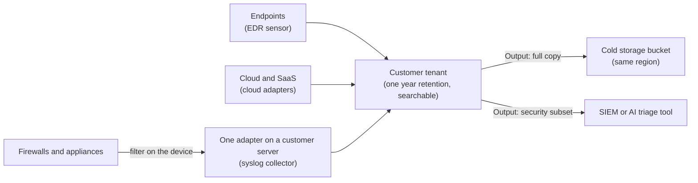

# Telemetry and Routing

Part of [Recommended Deployment for MSSPs](index.md).

The rule for telemetry is simple: bring in everything you need for detection and investigation, filter what you can at the source, and route copies out from the LimaCharlie cloud. This page covers each kind of source in the order you usually connect them, then the routing.

## Endpoints: the EDR sensor

Install the [endpoint agent](../../2-sensors-deployment/index.md) on every computer and server you monitor. It is the richest source you have, and Application Control, Vulnerability Reporting, Integrity, YARA scanning, live response and isolation all need it.

### What is included and what you turn on

The sensor's own events (processes, network connections, DNS, files, users and more) stream by default. The [Exfil extension](../../5-integrations/extensions/limacharlie/exfil.md) decides which event types reach the cloud. Its Watch Rules and Performance Rules thin out noisy servers.

Two log sources ride on the sensor but are **off by default**:

- **Windows Event Logs.** Add an [Artifact Collection](../../5-integrations/extensions/limacharlie/artifact.md) rule with a `wel://` pattern (for example `wel://system:*`) and enable the `WEL` event in Exfil. See [Ingesting Windows Event Logs](../../2-sensors-deployment/tutorials/windows-event-logs.md).
- **macOS Unified Logs.** Same idea with a `mul://` predicate and the `MUL` event. See [Ingesting macOS Unified Logs](../../2-sensors-deployment/tutorials/macos-unified-logs.md).

Streamed this way, these logs become timeline events and are included in the sensor's flat price. Pulling `.evtx` files instead is an artifact upload, billed as artifact data.

Linux audit logs are not part of the sensor stream. Collect them with the file adapter or Artifact Collection. See [Linux audit logs](../../2-sensors-deployment/tutorials/linux-audit-logs.md).

### Install at scale

Make one [installation key](../../2-sensors-deployment/installation-keys.md) per role and give each its tags, for example `server`, `workstation` and `vip`. Every sensor that enrolls with a key gets that key's tags, and those tags are what App Control policies, Host Posture rules, Deception policies, Exfil rules and your own D&R rules target later. Git Sync can create the same key names and tags in every tenant. The keys themselves are each organization's own enrollment credentials, so send each customer the keys from their own organization.

Use the tools the customer already has:

- Windows: the silent MSI with the installation key, through Group Policy, SCCM or Intune. See [Windows installation](../../2-sensors-deployment/endpoint-agent/windows/installation.md).
- macOS: [Jamf](../../2-sensors-deployment/endpoint-agent/macos/jamf.md) or [Intune](../../2-sensors-deployment/endpoint-agent/macos/intune.md), with the [MDM profiles](../../2-sensors-deployment/endpoint-agent/macos/mdm-profiles.md) that grant access in advance.
- Linux: the package or the raw binary. See [Linux installation](../../2-sensors-deployment/endpoint-agent/linux/installation.md).
- VDI and golden images: install in the template without enrolling. See [VDI templates](../../2-sensors-deployment/endpoint-agent/vdi/templates.md).

Add [Sensor Cull](../../5-integrations/extensions/limacharlie/sensor-cull.md) for fleets that churn, such as autoscaling groups and VDI pools. It deletes sensors that have been offline for a number of days, without confirmation, so scope its rules by tag.

### Sleeper mode

A sensor tagged `lc:sleeper` stays installed but dormant: it stops collecting telemetry and is billed only for connected time. Sleeper mode needs billing enabled on the organization. Put the tag on an installation key and machines enrolled with it go to sleep within about ten minutes.

To wake sensors, raise the organization's quota to cover them, then remove the tag in the web app or through the API. Allow up to ten minutes, with no reboot and no change on the host, and check that telemetry is arriving before an incident-response clock starts.

This is how Northwind pre-deploys to every ACME machine during onboarding while only monitoring the servers at first, and how it offers a retainer: the sensors are already there when an incident starts. See [Sleeper deployment](../../2-sensors-deployment/endpoint-agent/sleeper.md) and the [sleeper mode use case](../use-cases/sleeper-mode.md).

### How it is billed

Per endpoint per month, at a flat rate, with all the sensor's telemetry and a year of retention included by default. You do not estimate volume for endpoints. See [Estimating data ingestion](../../7-administration/billing/data-estimation.md).

## Logs: adapters

[Adapters](../../2-sensors-deployment/adapters/index.md) bring in everything that is not an endpoint sensor: cloud control planes, SaaS audit logs, identity providers, firewalls, servers, and other security tools. Each adapter is a sensor in the organization, so its events go through the same rules, Cases and Outputs.

There are three ways to run one. Pick in this order:

| Way | Where it runs | Where its configuration lives | Use it for |
| --- | --- | --- | --- |
| Cloud adapter (cloud-to-cloud) | LimaCharlie runs it | A `cloud_sensor` record | Any source reachable from the internet: Microsoft 365, Entra ID, Okta, Google Workspace, AWS, Azure, GCP, third-party EDR consoles |
| Cloud-managed adapter (External Adapter) | A binary on a customer host | An `external_adapter` record | Sources only reachable inside the customer network: syslog from firewalls, Windows Event Logs on a busy server, local files |
| Locally configured adapter | A binary on a customer host | A file on that host | Hosts where you want to manage the configuration file yourself. It still needs outbound access to LimaCharlie |

Cloud adapters need nothing at the customer. Declare them as `cloud_sensor` records and they start.

A [cloud-managed adapter](../../2-sensors-deployment/adapters/cloud-managed.md) needs the binary once, started with only the record's GUID and the organization ID. After that you change its configuration in the record, with `limacharlie external-adapter set` or in the web app, and the adapter picks the change up within about a minute. You never go back to the customer to edit a file. Know its documented limits before you rely on it:

- Changing `sensor_type`, or removing an option, applies only after the adapter process restarts.
- Disabling or deleting the record does not stop a running adapter. Stop it on the host first, then delete the record.
- `hive://secret/...` references are not resolved. The installation key and any source credential sit in the record itself, in plain text.
- Anyone with the organization ID and the record's GUID can read the record. Treat the GUID as a secret and keep it out of Git and tickets.

Because the record body holds credentials, keep `external_adapter` records out of Git Sync: leave `sync_hives.external_adapter` and `export_hives.external_adapter` off. Keep the record templates in your repository with placeholders, and have CI fill in the credentials from its own secret store and run `limacharlie external-adapter set` for each tenant.

### One collector for the customer's appliances

Put one cloud-managed adapter on a customer server as the [syslog](../../2-sensors-deployment/adapters/types/syslog.md) endpoint for their firewalls, switches and other appliances. With `client_options.mapping.sensor_key_path`, or a platform whose parser sets the key (such as `fortigate` or `cef`), each device becomes its own sensor in LimaCharlie. See [Adapter usage](../../2-sensors-deployment/adapters/usage.md). For alerting when one device stops sending, see [Non-responding sensors](../../2-sensors-deployment/troubleshooting/non-responding-sensors.md).

### Filter at the source

Adapter data is billed on what LimaCharlie receives. Mapping options such as `drop_fields` run in the cloud after receipt. They change the event that is stored, but the bytes were already counted. Data you never send is never billed, so filter where the data starts:

| Source | Where to filter |
| --- | --- |
| Firewalls and appliances | On the device: which facilities and severities it sends over syslog. Threat and deny logs instead of every allowed connection is the usual cut. There is no generic "drop events" filter inside the syslog adapter. |
| Windows Event Log adapter | XPath queries per channel in `evt_sources`. See [Windows Event Log adapter](../../2-sensors-deployment/adapters/types/windows-event-log.md). |
| macOS Unified Logging adapter | The `predicate`. See [macOS Unified Logging](../../2-sensors-deployment/adapters/types/mac-unified-logging.md). |
| Microsoft 365 | The `content_types` list. See [Microsoft 365](../../2-sensors-deployment/adapters/types/microsoft-365.md). |
| File adapter | The `file_path` glob. |

The [data estimation page](../../7-administration/billing/data-estimation.md) has typical volumes per source and company size. Network logs are usually the largest.

### A busy host

The sensor is a security sensor, not a log shipper. Its outbound queue is bounded. Under a sustained burst it drops the oldest events and sends a [`DATA_DROPPED`](../../8-reference/platform-events.md#data_dropped) event. On sensor 5.3.6 and later, a `get_debug_data` request returns the host's cumulative [`LOSS_ACCOUNTING`](../../8-reference/edr-events.md#loss_accounting) counters. For a host with sustained very high log volume, such as a large domain controller, keep the sensor for its EDR events and run the Windows Event Log adapter on that host for the event logs.

### How it is billed

Per GB that LimaCharlie receives, counted once at ingestion, with a year of retention included by default. A few third-party sources are billed on a plan of their own instead; the [pricing page](https://limacharlie.io/pricing) has the details. See [Estimating data ingestion](../../7-administration/billing/data-estimation.md) and the [billing FAQ](../../8-reference/faq/billing.md).

## Identity and SaaS

Connect these first after endpoints. They need nothing at the customer and are high-value and low-volume. Each is a cloud adapter:

- [Microsoft 365](../../2-sensors-deployment/adapters/types/microsoft-365.md) audit logs, and [Microsoft Entra ID](../../2-sensors-deployment/adapters/types/microsoft-entra-id.md) sign-ins.
- [Okta](../../2-sensors-deployment/adapters/types/okta.md), Duo, 1Password, Bitwarden.
- Google Workspace and Gmail.
- AWS CloudTrail and GuardDuty, Azure Event Hub and Monitor, GCP Pub/Sub.
- Third-party EDR and EPP consoles (CrowdStrike, Defender, SentinelOne and others), when the customer keeps one.

The full list is in [Adapters](../../2-sensors-deployment/adapters/index.md). For Globex, Northwind connects Okta and CloudTrail among the first sources. For Initech, Google Workspace.

Identity adapters matter for more than their own detections. Their events index users the same way Email Security indexes mailboxes, and Entities uses them as leads. See [What the products do together](synergy.md).

## Routing data out

With Insight on, LimaCharlie keeps a year of events searchable, so routing out is about what else needs a copy, not about storage. Do it with [Outputs](../../5-integrations/outputs/index.md) in the LimaCharlie cloud, not at the edge, so a change never needs the customer's firewall or a site visit.

The usual pattern for each customer:

1. **Unfiltered copy to cold storage.** An Output on the `event` stream to a bucket, such as [Google Cloud Storage](../../5-integrations/outputs/destinations/google-cloud-storage.md) or [Amazon S3](../../5-integrations/outputs/destinations/amazon-s3.md). This is your archive past one year and your source for anything you want to replay into another system later.
2. **Only the security subset downstream.** The `detect` stream to your SIEM, SOAR or AI triage tool, or a filtered `event` stream. An `event` output filters by event type (`event_white_list`, `event_black_list`) and by sensor tag. A `detect` output can also filter by detection category and rule tag. See [Filtering and transforming streams](../../5-integrations/outputs/stream-structures.md#filtering-and-transforming-streams). For finer control, a D&R rule's [`output` action](../../8-reference/response-actions.md#output) sends only the events it matches to a named output on the `tailored` stream.
3. **The audit stream to long-term storage**, for your own compliance.

Delivery is best effort, with retries and no durable queue. Send to a sink that is always up, such as a bucket, Pub/Sub or Kafka, and put slower systems behind it. Where a copy has a retention requirement, alert on `output_drop` events and check the archive for gaps. See [Output delivery](../../5-integrations/outputs/delivery.md).

Output credentials go in the `secret` hive and the output refers to them as `hive://secret/<name>`. Leave the `secret` hive out of Git Sync's sync and export settings, and the credentials never reach your repository.

### How it is billed

Outputs bill on egress, at cost. Outputs that use a GCP mechanism (`gcs`, `pubsub`, `bigquery`) with a destination in the same region as the LimaCharlie datacenter are not charged. The [Output billing](../../5-integrations/outputs/billing.md) page lists the region for each datacenter. Filtering in an output does not reduce what was ingested. Filtering at the source does.

Set [Usage Alerts](../../5-integrations/extensions/limacharlie/usage-alerts.md) on every tenant for output volume, so a runaway output shows up as a detection once it crosses your threshold. Usage Alerts do not watch ingestion. For that, have a scheduled job read each tenant's usage with `limacharlie org stats` and alert when ingestion jumps. The stats are totals per day and product for the whole organization, so they show that volume rose, not which device sent it. Then look at the event volume of the tenant's adapter sensors to find the source.

## Retention and search

With Insight on, every event from sensors and adapters is kept for one year by default and searchable with [LCQL](../../4-data-queries/index.md) in the Query Console, the CLI and the API. Searches are billed by the number of events evaluated, and the console shows an estimate before you run one (see [Query Console](../../4-data-queries/query-console-ui.md)). Narrow searches by sensor selector and event type to keep them fast and cheap. See [Query limits and performance](../../4-data-queries/query-limits-and-performance.md).

For anything past one year, either raise the organization's [retention](../../7-administration/extended-retention.md) to 18, 24 or 36 months, or use the bucket from step 1 above as the archive. Artifacts and product data such as cases have their own retention settings.

## In Git

| Piece | Where it lives |
| --- | --- |
| Installation keys and their tags | `installation_keys:` |
| Exfil, Artifact Collection rules | `extension_config` records `ext-exfil`, `ext-artifact` |
| Cloud adapters | `cloud_sensor` records |
| Cloud-managed adapters | `external_adapter` records, set from CI with `limacharlie external-adapter set`, not through Git Sync, because they hold credentials inline. Keep the GUIDs out of the repository too. |
| Outputs | `outputs:`, with `hive://secret/` references |
| Saved queries | `query` records |
| Usage Alerts, Sensor Cull | `extension_config` records |

See the [Git Sync reference](../../5-integrations/extensions/limacharlie/git-sync.md) and the [IaC tutorial](../mssp-iac-tutorial.md).
