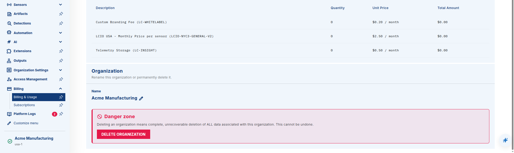
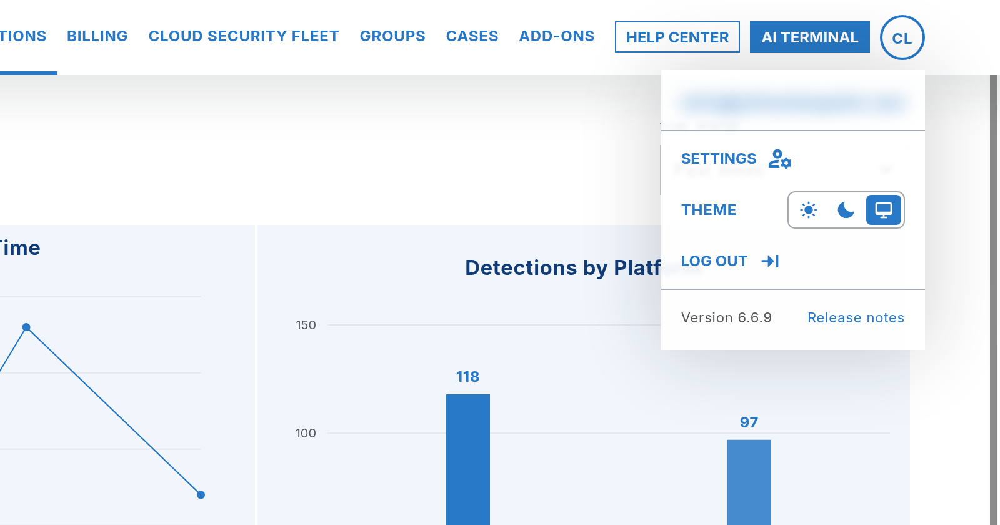
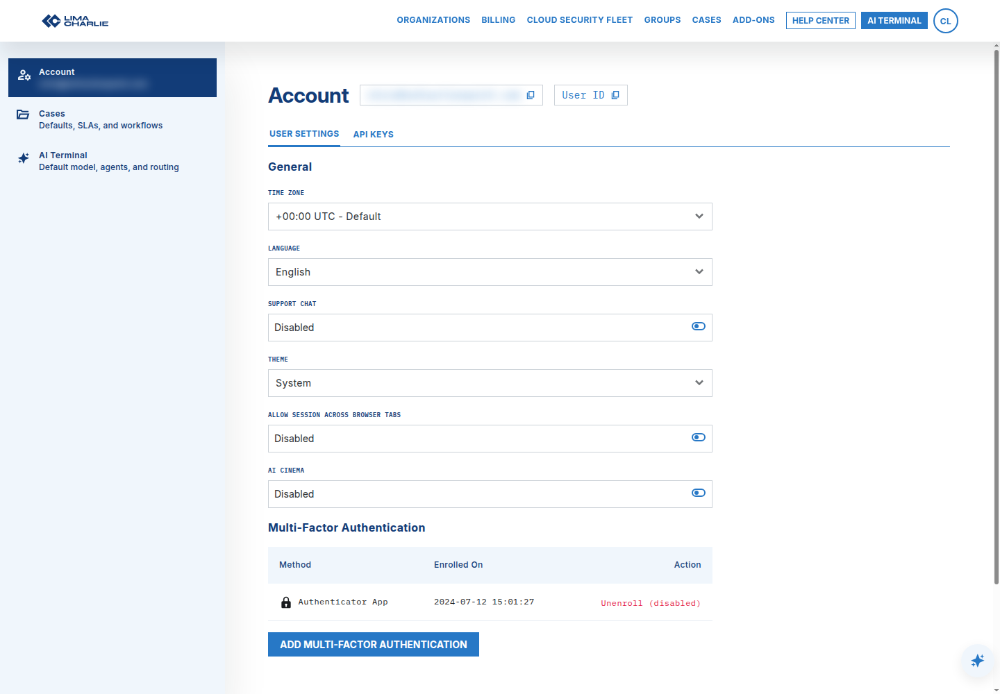

# FAQ - Account Management

## What Permission Do I Need to Create an Organization?

None. Any signed-in user can create an organization and becomes its Owner. The request has to come from a user, either a web login or a user API key. Organization API keys cannot create organizations. See [Organization Lifecycle](../../7-administration/org-lifecycle.md#creating-an-organization).

## How Can I Create More Than Two Organizations?

By default, you can create a new organization only while you are a direct member of fewer than two. Organizations you created and organizations you were added to individually both count. Access through an Organization Group does not. If you need more, reach out to the support team and we will change this limit. See [Organization limit](../../7-administration/org-lifecycle.md#organization-limit).

## Which Region Codes Can I Use When Creating an Organization?

`usa`, `canada`, `europe`, `uk`, `india`, `australia`, or `auto`. The region cannot be changed after creation, and `auto` only picks `usa`, `europe` or `australia`, so name the region in automation. The full table with GCP regions is in [Regions](../../7-administration/org-lifecycle.md#regions).

## How Do I Delete an Organization?

You need both `billing.ctrl` and `user.ctrl` on the organization, which among the built-in roles only Owner has. Navigate to the bottom of the Billing & Usage section of the organization you want to delete, and click Delete Organization button. Note that this action is final and cannot be undone.

Deletion is also available through the API, SDKs and CLI, and does not uninstall agents from endpoints. See [Deleting an Organization](../../7-administration/org-lifecycle.md#deleting-an-organization) for the steps and an offboarding checklist.

## Can I Install a Private Extension in My Customers' Organizations?

Yes, if you own the extension and hold `billing.ctrl` and `user.ctrl` on the customer organization. See [Private extensions in other organizations](../../5-integrations/extensions/using-extensions.md#private-extensions-in-other-organizations).

## How Do I Rotate an API Key?

Create a new key, switch your clients to it, then delete the old one. See [Rotating API keys](../../7-administration/access/api-keys.md#rotating-api-keys).

## Is There a Way to Wipe an Organization?

You can wipe the data retention by deleting the `Insight` add-on (using `DELETE /insight/{oid}`) and re-enabling it again. Please note that disabling `Insight` (unsubscribing from the marketplace) will only pause data collection but will **not** delete historical telemetry. To permanently delete all stored telemetry for a selected organization, you must explicitly issue a delete operation, and this action cannot be undone.

To wipe the configuration, you can use Templates / Infrastructure as Code functionality with the `is_force` flag to remove everything. To learn more about the infrastructure as code, visit [Infrastructure Extension](../../5-integrations/extensions/limacharlie/infrastructure.md).

## Can I Transfer Ownership of an Organization?

You can transfer ownership of an organization to any other entity. The request needs to be initiated by the current owner (billing or legal contact) of the organization. To do so, contact [support@limacharlie.io](mailto:support@limacharlie.io).

## I Created an Account and Have Been Given Access, but I Do Not Seem to Have Access to Other Organizations

With LimaCharlie's granular role-based access control you can be granted access in one of two ways:

- On a per-organization basis
- To a set of organizations using [Organization Groups](../../7-administration/access/user-access.md)

You'll want to ask the person who granted access if they added you to the individual organizations, or if they'd set up an organization group.  Either method works, but they'll have to ensure that either you're added to each organization individually, or that they set up a group.

## How Can I Update My Time Zone?

All dates and times displayed in the web app follow the user preferred time zone.

To set your time zone, navigate to the settings icon in the right hand corner and select `Manage User Settings`.

You can set your preferred time zone under `Display` section of the `User Settings`; all changes are saved automatically.

## How Can I Unsubscribe/Cancel/Delete My Limacharlie Account?

You can unsubscribe / cancel your subscription from app.limacharlie.io by logging in and going to the Billing & Usage under the Billing section. Click the Delete Organization button at the bottom of the page and follow the instructions on screen. See [Organization Lifecycle](../../7-administration/org-lifecycle.md#deleting-an-organization) for who can delete and what deletion removes.

## Why Didn't I Receive My Account Activation Email?

Account activation emails are sent when you sign up for a new LimaCharlie account. If you do not see the activation email in your inbox, it can typically be found in a spam / junk folder. If you're a user of Microsoft Office 365, or similar service that has server-side filtering, you may wish to check your online Quarantine (or equivalent). See the [Microsoft instructions](https://docs.microsoft.com/en-us/microsoft-365/security/office-365-security/quarantine-email-messages?view=o365-worldwide) for details.

Please reach out to our support team and we can verify if a successful delivery response message was received from your mail server.

In LimaCharlie, an Organization represents a tenant within the Agentic SecOps Workspace, providing a self-contained environment to manage security data, configurations, and assets independently. Each Organization has its own sensors, detection rules, data sources, and outputs, offering complete control over security operations. This structure enables flexible, multi-tenant setups, ideal for managed security providers or enterprises managing multiple departments or clients.

Infrastructure as Code (IaC) automates the management and provisioning of IT infrastructure using code, making it easier to scale, maintain, and deploy resources consistently. In LimaCharlie, IaC allows security teams to deploy and manage sensors, rules, and other security infrastructure programmatically, ensuring streamlined, repeatable configurations and faster response times, while maintaining infrastructure-as-code best practices in cybersecurity operations.
